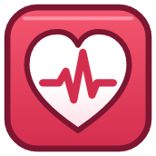
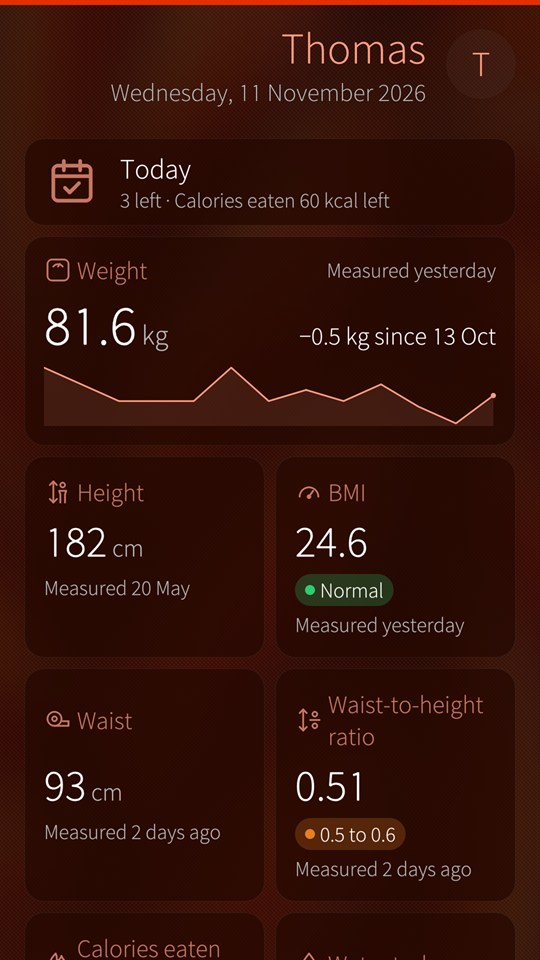
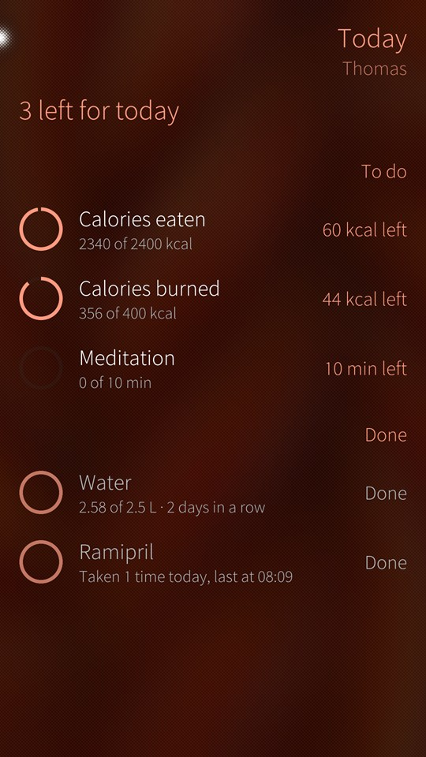
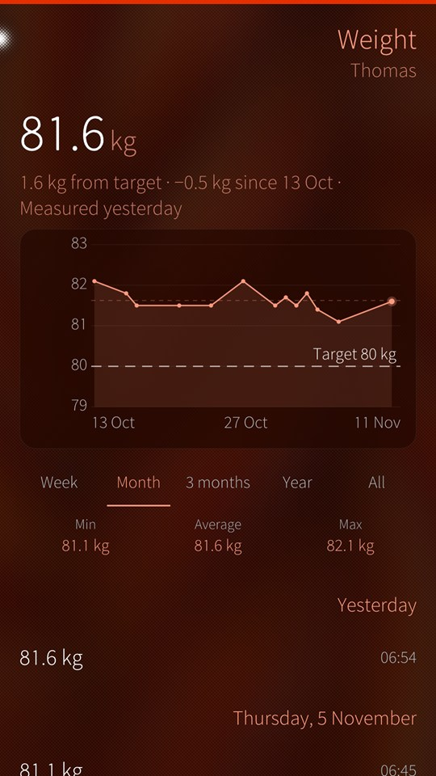
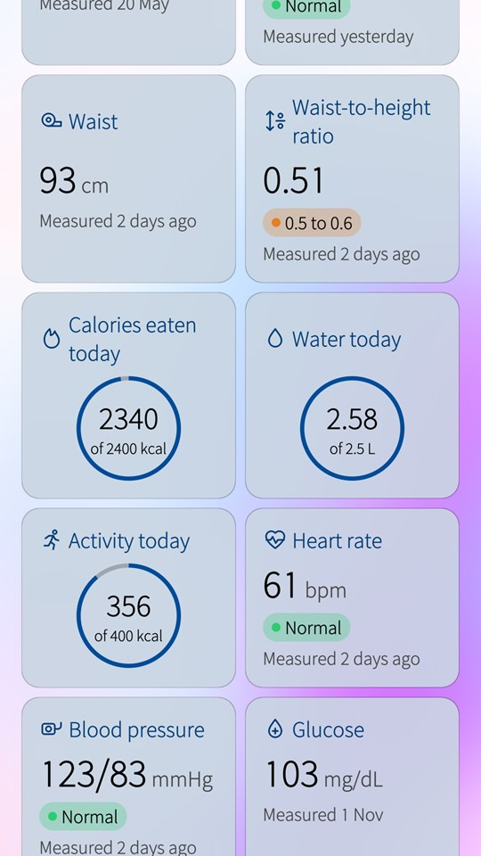
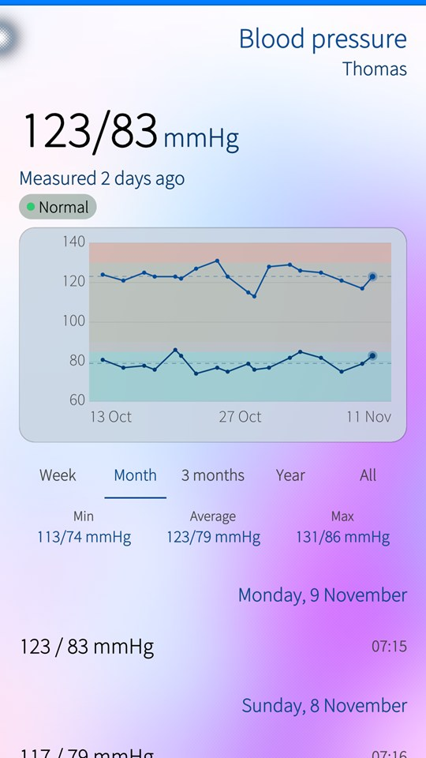
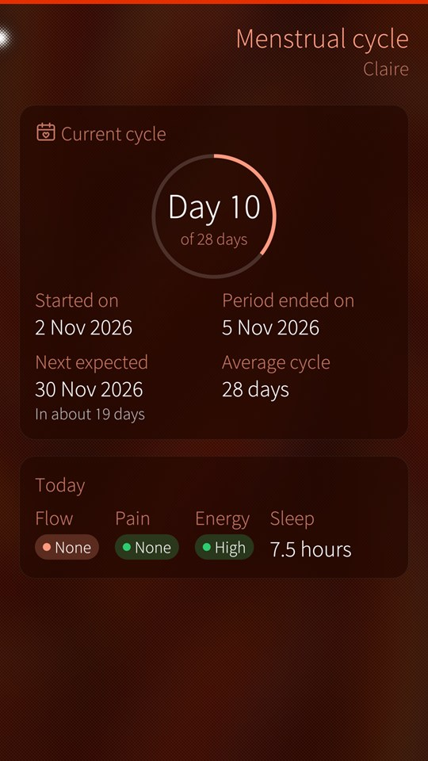

<p align="center">
  
</p>

<h1 align="center">Health for Sailfish OS</h1>

<p align="center">
  <b>Track your health, privately on your Sailfish OS phone.</b><br>
  Weight, blood pressure, water, medication, cycle and more, with clear charts and daily goals.<br>
  No account, no cloud, no network permission. All locally on your phone.
</p>

<table>
  <tr>
    <td><a href="docs/images/dashboard.jpg"></a></td>
    <td><a href="docs/images/today.jpg"></a></td>
    <td><a href="docs/images/weight.jpg"></a></td>
  </tr>
  <tr>
    <td><a href="docs/images/dashboard-light.jpg"></a></td>
    <td><a href="docs/images/blood-pressure-light.jpg"></a></td>
    <td><a href="docs/images/cycle.jpg"></a></td>
  </tr>
</table>

## What you get

- **A dashboard that you can customize.** One card for everything you track, with its trend or its goal ring. Arrange it, hide what you do not use, and give every member of the family their own.
- **Today at a glance.** What is left for the day: water and calories, meditation, the medications you are on. Keep a goal several days running and watch the streak grow.
- **Charts.** Every measurement by week, month or year, over its reference ranges, with a line for your daily goal or your target weight.
- **Everything in one place.** Weight, height, BMI, waist, water, calories eaten and burned, heart rate, blood pressure and glucose, in your units: kg or lb, cm or in, L or fl oz, mg/dL or mmol/L.
- **More than numbers.** Health conditions, treatments and medication intakes, vaccines, a meditation timer, and menstrual cycle tracking.
- **Cover support.** Two measurements or the day's list, without opening the app, and a glass of water in one tap.
- **Private and safe.** Your data never leaves the device. Health keeps automatic copies of the last days, backs up to a file you can restore on another phone, and exports CSV files.

Health is not medical advice and must not be used for diagnosis or treatment decisions.

## Get it

Health is in the Jolla Store and in OpenRepos. It follows your ambience, light or dark, and is available in multiple languages.

## For developers

Build and validate with the Sailfish SDK (`sfdk tools list` shows your targets), or with the Sailfish IDE:

```
sfdk -c target=SailfishOS-5.1.0.11-aarch64 build
sfdk -c target=SailfishOS-5.1.0.11-aarch64 check
```

The package version comes from the latest git tag, so tag the release commit (for example `2.0`) before building it; the About page shows the same version. The build also refreshes the translation catalogues in `translations/`, where new languages are welcome.

## Authors

Health started in 2022 as a software engineering course project at the Université de Pau et des Pays de l'Adour (France), by students under the supervision of Prof. Adel Noureddine, and has grown since with contributions from the open source community.

Adel Noureddine (project lead and maintainer, © 2022).

Dylan Mignot-Bousseau, Lucille Rey, Mathieu Vazquez, Angel Gezat, Bienvenu Akoun, Thomas Abadie, Ashraf Ajouka, Jose Buepoyo Sopale and Charlotte Ortali (students, © 2022). Maarten Vanraes (© 2026). Ilies Hamadene (student, © 2026).

## License

Health is licensed under the GNU GPL 3 license only (GPL-3.0-only).

Copyright (c) 2022-2026, Adel Noureddine, and contributors.
All rights reserved. This program and the accompanying materials are made available under the terms of the GNU General Public License v3.0 only (GPL-3.0-only) which accompanies this distribution, and is available at: https://www.gnu.org/licenses/gpl-3.0.en.html
